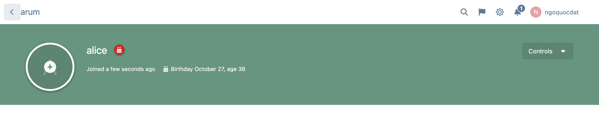
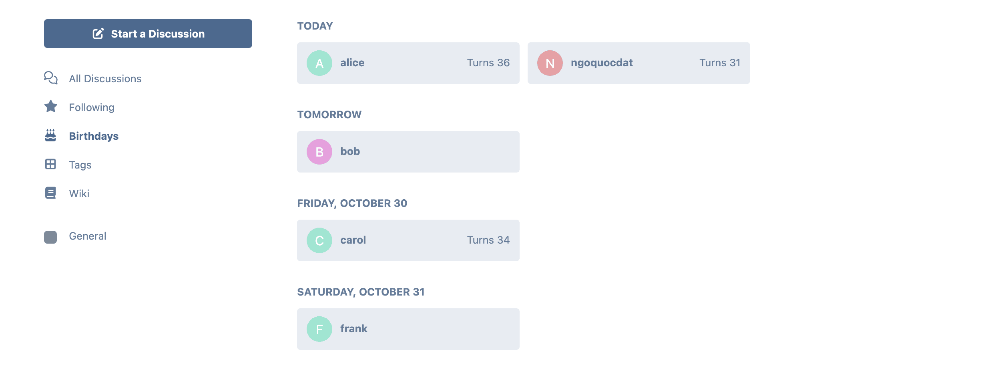
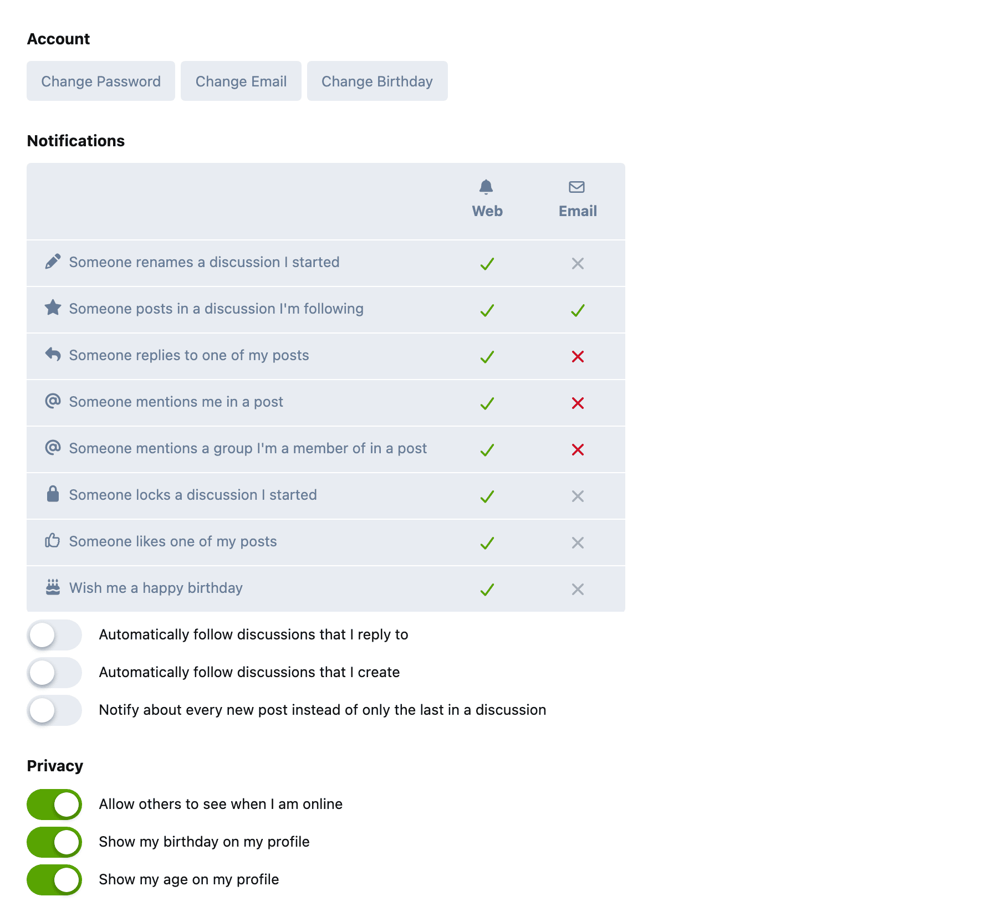

# Birthdays

 [](https://packagist.org/packages/datlechin/flarum-birthdays) [](https://packagist.org/packages/datlechin/flarum-birthdays)

A [Flarum](https://flarum.org) extension. Birthdays for your members.

- Birthday and age on the profile, each one only if the member chooses to show it
- A cake badge next to the member's name on their birthday
- A Birthdays page listing who celebrates today and in the next seven days
- A "happy birthday" notification on the day
- Birthday at sign-up: not asked, optional or required, with a minimum age
- Birthday column in the admin users list

Only the member and moderators who can edit them see the full date. Everyone else gets the parts the member chose to show.





## Installation

```sh
composer require datlechin/flarum-birthdays
```

The birthday notification is sent by a scheduled command. Make sure the [Flarum scheduler](https://docs.flarum.org/2.x/scheduler) runs, or call `php flarum birthdays:notify` once a day yourself.

## Updating

```sh
composer update datlechin/flarum-birthdays
php flarum migrate
php flarum cache:clear
```

### From 2.x

3.0 keeps every birthday and each member's show/hide choices. Things that changed:

- "Set on registration" and "Required" are now one setting with three choices. The migration carries your choice over.
- The two date format settings are gone. Dates follow the forum language, and language packs can translate the `datlechin-birthdays.lib.datetime_formats` keys.
- The API attributes `showDobDate`, `showDobYear` and `canEditOwnBirthday` are now `showBirthday`, `showAge` and `canEditBirthday`. Other users get `birthMonthDay` (`MM-DD`) and `age` instead of the full `birthday`.

## Links

- [Packagist](https://packagist.org/packages/datlechin/flarum-birthdays)
- [GitHub](https://github.com/datlechin/flarum-birthdays)
- [Discuss](https://discuss.flarum.org/d/29793)
